# agent-home

Sync global agent instructions and personal skills across computers and harnesses
through Git. Especially useful for remote-envs: remote development environments
where you launch and control agents from another computer.



## Set up your repository

You need Python 3.10+, Git, and GitHub authentication on each computer.

Your personal context stays in your private repository, while program updates
come from this public project.

Do this once. If you already have your private repository, continue with [Installation](#installation).

Create an **empty private repository** on GitHub, for example
`agent-home-personal`, then run:

```sh
git clone https://github.com/adrilasar/agent-home.git agent-home-personal
cd agent-home-personal
git remote rename origin upstream
git remote add origin https://github.com/YOUR-ACCOUNT/YOUR-REPO.git
git config remote.pushDefault origin
git push -u origin main
```

Replace `YOUR-ACCOUNT/YOUR-REPO` with your private repository's path.
The repository and local folder names are your choice.

`origin` points to your repository; `upstream` points to this public project
for future updates.

## Installation

**If you just completed setup,** continue in the same directory.

**On another computer,** clone your private repository first:

```sh
git clone https://github.com/YOUR-ACCOUNT/YOUR-REPO.git agent-home-personal
cd agent-home-personal
git remote add upstream https://github.com/adrilasar/agent-home.git
```

Choose a computer name using lowercase letters, numbers and hyphens. Use
`machines/example/` as a starting point to create `machines/COMPUTER-NAME/`
and add that computer's instructions and skills.

Before installing, copy any existing global instructions into the appropriate
`FRAGMENT.md` files and personal skills into `skills/` folders. **Installation
replaces managed files; it does not merge their existing content.** Commit and
push your changes.

From your personal clone, run:

```sh
# Windows: py -3 agent_home.py install COMPUTER-NAME codex claude
python3 agent_home.py install COMPUTER-NAME codex claude
```

Replace `COMPUTER-NAME` with the name you chose. Available harnesses are `codex`
and `claude`; list the ones you want to use.

You can run `install` again to change the configured harnesses. The command
shows the changes and asks for confirmation when reinstalling.

Installation applies the files and schedules synchronization every 15 minutes.

## Usage and synchronization

Ask your agent to update your global instructions or personal skills, or edit the
repository sources yourself. The included [`manage-personal-context`](common/skills/manage-personal-context/SKILL.md)
skill provides
agents with the repository and synchronization details.

Installed copies are generated. Once changes reach your repository's `main`, your
computers receive them automatically. To sync immediately:

```sh
# Windows: py -3 agent_home.py sync
python3 agent_home.py sync
```

> Automatic synchronization requires the installation clone to be on `main`,
> with no uncommitted changes or unpublished commits.

### Receive project updates

To bring updates from the public project into your private repository:

```sh
git switch main
git pull --ff-only origin main
git fetch upstream
git merge upstream/main
git push origin main
```

You choose when to bring in public updates.

## Organization

Sources are combined in this order:

1. `common/`: all computers and harnesses.
2. `harnesses/<harness>/`: one harness (`codex` or `claude`).
3. `machines/<computer>/`: one computer.
4. `machines/<computer>/harnesses/<harness>/`: one combination.

Each scope can contain:

- `FRAGMENT.md`: instructions concatenated into the global instructions file.
- `skills/<name>/SKILL.md` and resources: skills copied in full. Skill names must
  be unique across the selected scopes.

`common/FRAGMENT.md` applies to every computer. Each computer also receives
its own `machines/<computer>/FRAGMENT.md`.

<details>
<summary>Example: combining instruction fragments</summary>

`common/FRAGMENT.md`:

```markdown
<!-- Example: replace or remove this content before use. -->
Keep explanations concise.
```

`machines/example/FRAGMENT.md`:

```markdown
<!-- Example: replace or remove this content before use. -->
This computer is named `example`.
```

On the `example` computer, the generated `AGENTS.md` or `CLAUDE.md` combines both:

```markdown
<!-- Generated by agent-home. Edit the repository sources. -->

<!-- common/FRAGMENT.md -->
<!-- Example: replace or remove this content before use. -->
Keep explanations concise.

<!-- machines/example/FRAGMENT.md -->
<!-- Example: replace or remove this content before use. -->
This computer is named `example`.
```

</details>

Files are installed into:

- **Codex:** `~/.codex/AGENTS.md` and `~/.codex/skills/` (respects `CODEX_HOME`).
- **Claude Code:** `~/.claude/CLAUDE.md` and `~/.claude/skills/`.

This program manages global instructions and personal skills. It does not modify
instructions or skills inside project repositories.

## Uninstallation

```sh
# Windows: py -3 agent_home.py uninstall
python3 agent_home.py uninstall
```

> Removes scheduled synchronization, state, and backups. Preserves installed
> instructions, skills, and the repository clone.

## License

MIT. See [LICENSE](LICENSE).
